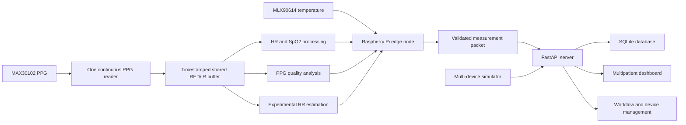

# EdgeER

**EdgeER** is an investigational edge-assisted multipatient monitoring and reassessment workflow prototype. It demonstrates low-cost sensing, continuous physiological signal acquisition, confidence-aware measurement handling, distributed device communication, centralized workflow management, persistent event tracking, and engineering fault testing.

> **Safety notice:** EdgeER is not a medical device and is not intended for diagnosis, treatment, clinical deployment, or patient-care decisions.

## Purpose

EdgeER explores how low-cost edge nodes and a centralized dashboard can support repeated monitoring and reassessment workflows for multiple patients or simulated patients. The project emphasizes engineering reliability, transparent treatment of uncertain measurements, device and encounter lifecycle management, and reproducible testing.

## Core capabilities

- Raspberry Pi physical sensing node
- Shared continuous MAX30102 PPG acquisition pipeline
- Buffered heart-rate and SpO2 processing
- Experimental confidence-gated PPG-derived respiratory rate
- MLX90614 temperature acquisition with range sanitization
- FastAPI server and SQLite persistence
- Patient registration and encounter management
- Registry-backed device assignment and lifecycle handling
- Priority, recheck, escalation, dismissal, readmission, and handoff workflows
- Offline-device detection and packet audit logging
- Multi-device simulator with fault scenarios
- Reproducible software-validation suite

## Engineering validation highlights

- 83 automated tests passed
- 45/45 packet-validation cases passed
- 0 false acceptances and 0 false rejections in the validation matrix
- 31/31 device-lifecycle checks passed
- 3/3 complete deterministic workflow scenarios passed
- 10/10 simulated disconnect/reconnect cycles passed
- 20/20 shared-PPG architecture assertions passed
- Simulated loads evaluated at 1, 5, 10, and 20 devices
- Exploratory consumer pulse-oximeter comparison completed
- Exploratory RR confidence-gating evaluation completed
- Idle and active power ranges logged

## Architecture



## Documentation

- [Project status](PROJECT_STATUS.md)
- [Version 1.0 scope](V1_SCOPE.md)
- [Documentation index](docs/README.md)
- [System architecture](docs/SYSTEM_ARCHITECTURE.md)
- [Setup](docs/SETUP.md)
- [Testing](docs/TESTING.md)
- [Validation summary](docs/SOFTWARE_VALIDATION.md)
- [Bench evaluation](docs/BENCH_EVALUATION.md)
- [Safety and intended use](docs/SAFETY_AND_INTENDED_USE.md)
- [Limitations](docs/LIMITATIONS.md)
- [Future work](docs/FUTURE_WORK.md)
- [Technical report](docs/technical_report/EdgeER_Complete_Technical_Report.pdf)

## Repository layout

```text
EdgeER/
├── edge-node/                 Raspberry Pi sensing and signal processing
├── server/                    FastAPI server, database, and dashboard
├── simulator/                 Multi-device and fault-scenario simulation
├── tools/software_validation/ Reproducible software-validation tooling
├── results/                   Generated engineering evidence
└── docs/                      Public technical documentation
```

## Quick start

See [docs/SETUP.md](docs/SETUP.md) for full environment and hardware instructions.

Server:

```powershell
cd server
python -m pip install -r requirements.txt
python server.py
```

Raspberry Pi edge node:

```bash
cd edge-node
source .venv/bin/activate
python main.py
```

Software validation:

```powershell
python tools/software_validation/run_all_software_validation.py --quick
```

## Project status

The current project is a software-stable release candidate. ESP32 nodes, structured NEWS2 completeness handling, blood-pressure support, larger physical-device fleets, expanded sensor evaluation, and clinical research are explicitly tracked as future work rather than v1.0 requirements.

## License

A public license should be selected before publication. See [LICENSE_NOTE.md](LICENSE_NOTE.md).
