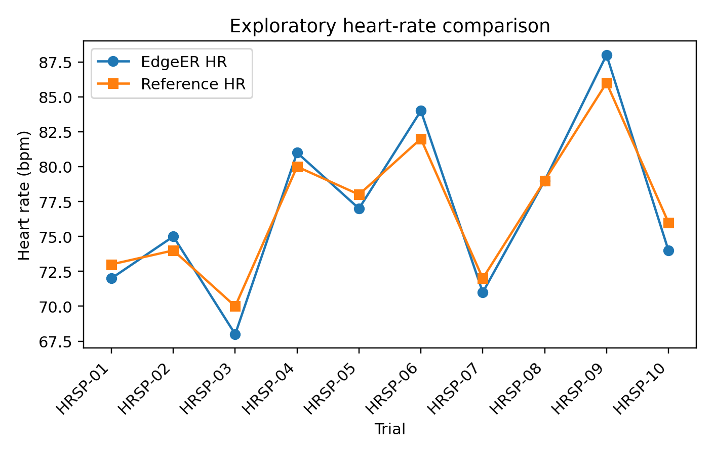
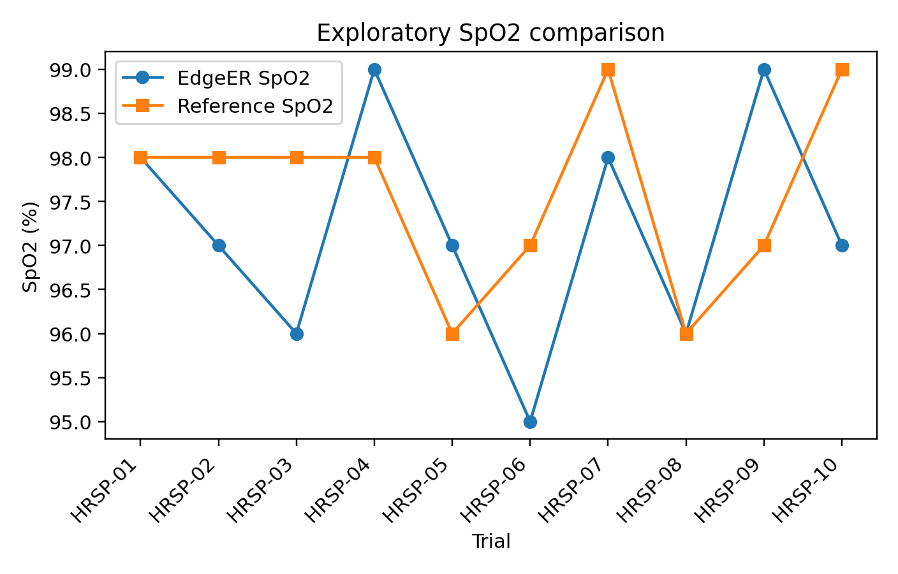
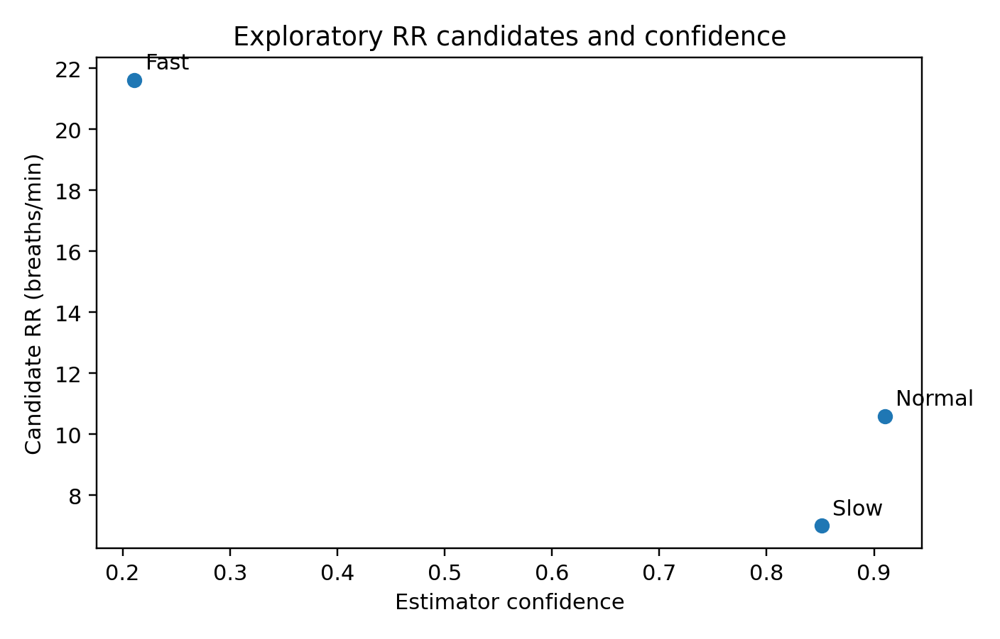
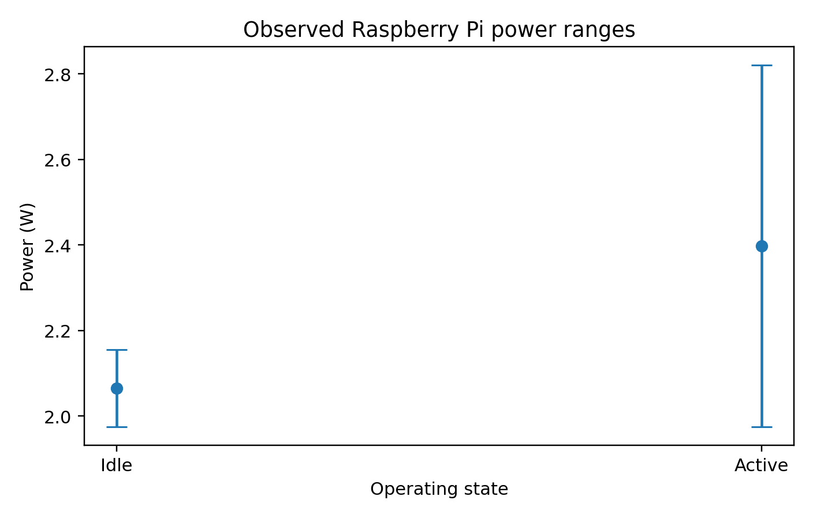

# Exploratory Bench Evaluation

## Consumer pulse-oximeter comparison

Ten paired observations compared EdgeER with a Zacurate 500 Series consumer fingertip pulse oximeter under seated resting, seated recovery, minor movement, and post-light-walking conditions.

| Metric | Heart rate | SpO2 |
|---|---:|---:|
| Trials | 10 | 10 |
| Mean absolute difference | 1.30 bpm | 1.20 percentage points |
| RMSE | 1.45 bpm | 1.41 percentage points |
| Mean signed difference | -0.10 bpm | -0.40 percentage points |
| Maximum absolute difference | 2 bpm | 2 percentage points |
| Within +/-2 | 100% | 100% |

This is an exploratory comparison with a consumer reference device. It does not establish clinical accuracy.

## Exploratory PPG-derived RR

| Condition | Expected RR | Candidate RR | Confidence | Quality | Transmitted |
|---|---:|---:|---:|---|---|
| Normal | 12.0 | 10.6 | 0.910 | GOOD | Yes |
| Slow | 7.0 | 7.0 | 0.851 | MODERATE | Yes |
| Fast | 22.0 | 21.624 | 0.211 | LOW_CONFIDENCE | No |

The fast-breathing candidate was numerically close to the manual reference but was withheld because competing respiratory-band evidence reduced confidence. This illustrates the distinction between candidate accuracy and evidence quality.

## Power observations

Voltage remained between 5.365 and 5.373 V in both idle and active observations.

| State | Current range | Typical current | Power range | Typical power |
|---|---|---|---|---|
| Idle | 0.368-0.401 A | 0.368-0.372 A | 1.974-2.155 W | 1.976-1.997 W |
| Active | 0.368-0.525 A | 0.414, 0.418, 0.444 A | 1.974-2.821 W | 2.223, 2.244, 2.384 W |

Power was calculated from the logged voltage and current observations using `P = V x I`.

Raw supporting data are available in [data/EdgeER_Bench_Evaluation_Data.zip](data/EdgeER_Bench_Evaluation_Data.zip).
