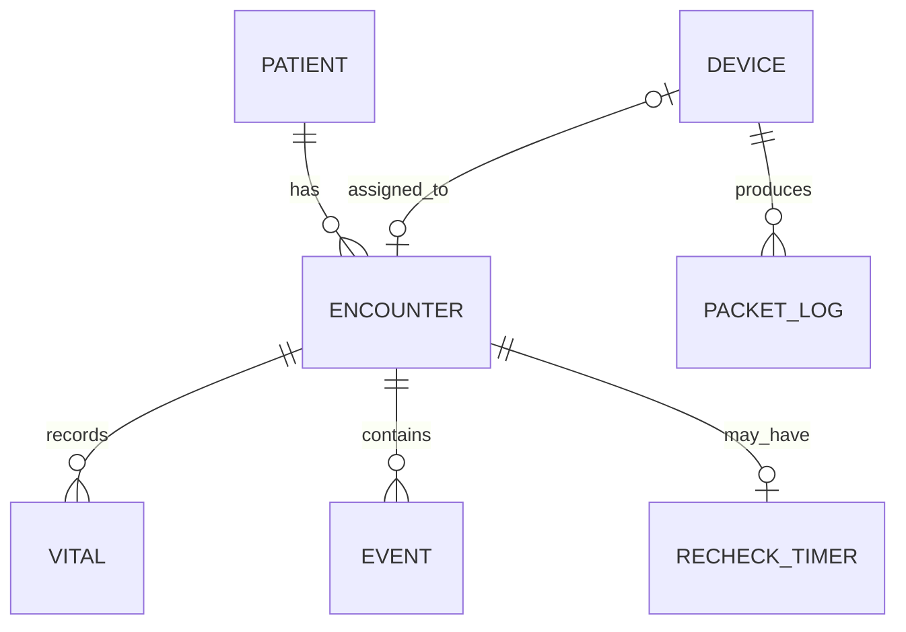

# Database Schema Overview

EdgeER uses SQLite with write-ahead logging for local persistence. Exact column definitions are maintained by the server migrations; this document describes the logical model.

## Core entities

### Patient profiles

Stores stable registration attributes such as patient identifier, display name or anonymous code, age, complaint, triage level, and location.

### Encounters

Represents each admission or monitoring episode. Readmission creates a new encounter so prior history remains preserved.

### Devices

Stores device identifier, type, operational state, lifecycle state, assignment, connectivity, last-seen information, and retirement metadata where applicable.

### Latest patient state

Stores the most recent accepted measurements and workflow status for the active encounter.

### Recent vitals

Stores bounded or policy-controlled measurement history for patient detail views and handoff generation.

### Packet logs

Append-only audit records for accepted and rejected packets, including validation outcomes and rejection reasons.

### Patient events

Stores escalation, de-escalation, nurse actions, doctor notification, medication, dismissal, readmission, and notes.

### Recheck timers

Persists reassessment deadlines and reminder state across refreshes and server restarts.

## Lifecycle relationships

## Integrity behavior

The validation suite verified application restart persistence, SQLite integrity checks, foreign-key checks, device retirement preservation, and current-versus-historical encounter separation using isolated temporary databases.
