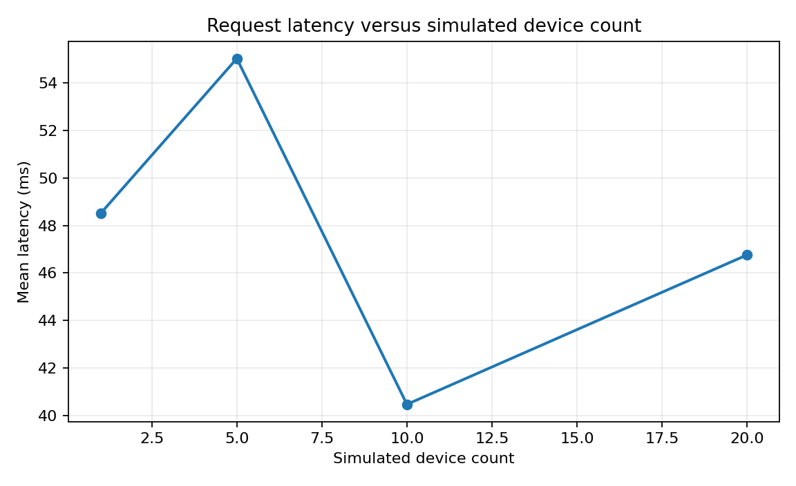
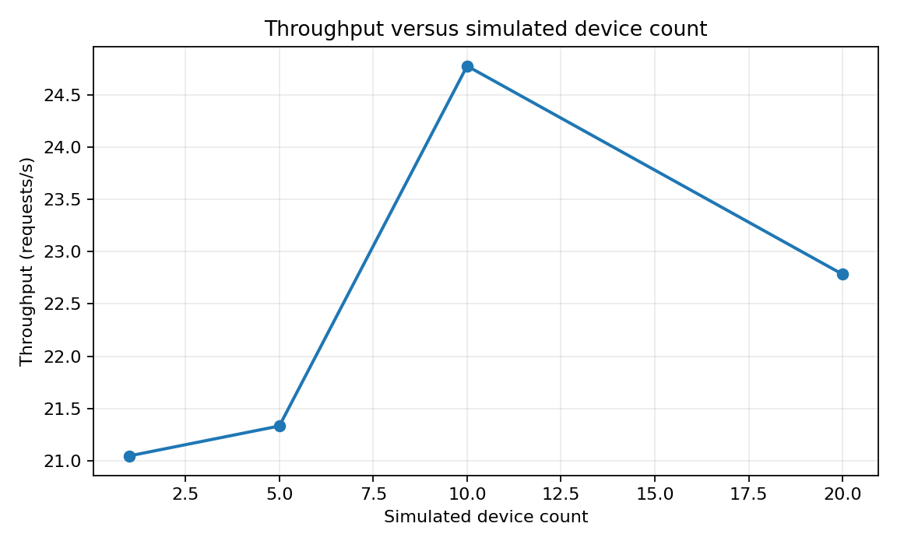

# Software Validation Summary

## Scope

The Windows software-validation suite exercised server validation, device lifecycle, workflow persistence, database integrity, simulator scaling, reconnection behavior, API performance, dashboard contracts, and shared-PPG software architecture without contacting physical hardware.

## Functional results

| Validation group | Result |
|---|---:|
| Automated tests | 83 passed, 0 failed |
| Packet validation | 45/45 passed |
| False acceptances | 0 |
| False rejections | 0 |
| Device lifecycle | 31/31 passed |
| Complete workflow scenarios | 3/3 passed |
| Database persistence | 6/6 passed |
| Simulated reconnect cycles | 10/10 passed |
| Dashboard contract checks | 22/22 passed |
| Shared-PPG assertions | 20/20 passed |

## Scalability smoke evaluation

| Simulated devices | Accepted packets | Mean latency | p95 latency | Throughput | DB growth |
|---:|---:|---:|---:|---:|---:|
| 1 | 344 | 44.21 ms | 49.48 ms | 22.80 req/s | 585,728 B |
| 5 | 379 | 40.02 ms | 53.42 ms | 25.11 req/s | 630,784 B |
| 10 | 372 | 40.77 ms | 57.47 ms | 24.56 req/s | 638,976 B |
| 20 | 358 | 42.31 ms | 59.06 ms | 23.79 req/s | 675,840 B |

These measurements used in-process FastAPI TestClient execution. They characterize application behavior under the specified test harness and are not physical-network capacity claims.

## Reconnection

Ten deterministic simulated disconnect/reconnect cycles passed. With a configured offline timeout of 15 seconds, the mean observed offline-detection time was 16.106 seconds. Mean recovery time was 39.15 ms, with p95 recovery of 40.58 ms.

## API latency

| Endpoint category | p95 | p99 |
|---|---:|---:|
| Device list | 3.46 ms | 3.54 ms |
| Patients | 1.62 ms | 1.79 ms |
| History | 1.41 ms | 1.63 ms |
| Packet logs | 3.57 ms | 3.81 ms |
| Encounters | 2.53 ms | 2.65 ms |
| Handoff | 2.69 ms | 2.79 ms |
| Vitals ingestion | 47.49 ms | 48.43 ms |
| Workflow action | 20.38 ms | 30.94 ms |

