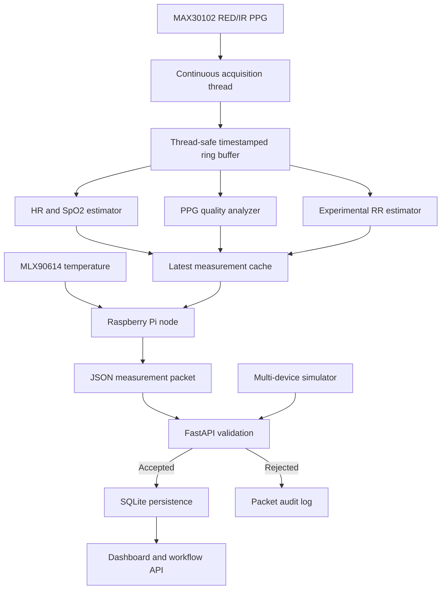

# System Architecture

## Overview

EdgeER separates sensor acquisition, signal processing, packet validation, persistence, and workflow presentation. The Raspberry Pi node performs edge acquisition and preliminary signal processing, while the central server remains authoritative for patient encounters, device assignments, workflow states, and audit history.

## Key design decisions

### One hardware reader

Only one acquisition component reads the MAX30102 FIFO during normal operation. HR, SpO2, PPG-quality, and RR estimators consume snapshots from the same shared buffer. This prevents competing FIFO resets and inconsistent sample windows.

### Confidence-aware measurements

Experimental RR is transmitted numerically only when the estimate is usable and classified as GOOD or MODERATE. Low-confidence or unavailable candidates are represented as null while preserving source, quality, and confidence metadata.

### Server authority

The server controls patient encounters, device assignment, retirement state, priority workflow, timers, dismissal, readmission, and handoff generation. Edge-node status is treated as provisional telemetry rather than a final clinical decision.

### Persistent audit trail

Accepted and rejected packets, current device state, encounters, events, and timers are stored in SQLite. Packet rejection reasons support engineering diagnosis and reproducibility.
